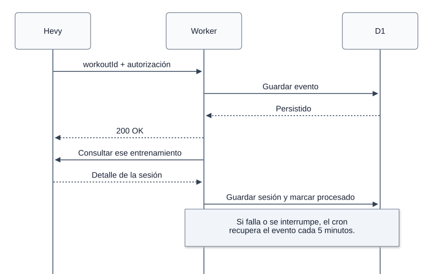

# Arquitectura

## Dos flujos independientes

El CLI descarga B, D, E y su historial directamente desde Hevy y genera archivos locales en `data/`. El receptor de Cloudflare recibe solo avisos nuevos y consulta el detalle de ese ID. No se suben rutinas, historial anterior ni archivos locales.

## Recepción de un entrenamiento

El receptor valida el aviso y lo guarda en D1 antes del 200 que Hevy espera dentro de cinco segundos. La consulta a Hevy se hace aparte. Un cron cada cinco minutos recupera pendientes o reservas vencidas; los avisos repetidos no duplican sesiones.

## Accesos

| Ruta | Acceso | Función |
| --- | --- | --- |
| `GET /health` | Público | Confirmar que responde el Worker. |
| `POST /webhooks/hevy` | `HEVY_WEBHOOK_AUTH` | Recibir un workoutId nuevo. |
| `GET /api/workouts` | `READ_API_AUTH` | Leer hasta 50 entrenamientos procesados por página con cursor. |

`HEVY_API_KEY` consulta Hevy. Los otros dos secretos son encabezados diferentes para recepción y lectura; ninguno se publica en el repositorio. Los valores viven en Cloudflare Secrets y archivos privados locales.

## Decisiones que importan

- **Workers Free + D1 Free:** recibir datos con la computadora apagada, manteniendo el presupuesto gratuito.
- **Persistir antes de confirmar:** recuperar procesos interrumpidos porque el evento ya está guardado.
- **Solo entrenamientos nuevos en la nube:** mantener separada la descarga local completa.

El cron recupera avisos ya guardados; no descubre los que nunca llegaron. Las ediciones y eliminaciones posteriores no se sincronizan por este webhook. Todavía no hay descarga desde Cloudflare al CLI, recomendaciones automáticas ni un agente de IA en ejecución.

## Editar los diagramas

Fuentes: [components.mmd](diagrams/components.mmd) y [workout-ingestion.mmd](diagrams/workout-ingestion.mmd). Los SVG incluyen fondo blanco fijo. Usar [mermaid-config.json](diagrams/mermaid-config.json), renderizar con `mmdc -b white -c <config> -i <fuente> -o <svg>` y conservar el rectángulo blanco de fondo, los espacios de texto y un ID distinto por diagrama. Revisar textos, flechas y espaciado antes de reemplazar la imagen.

Código: [CLI](../../fitness_agent/cli.py), [Worker](../../cloudflare/src/worker.mjs) y [esquema D1](../../cloudflare/migrations/0001_webhooks.sql).
